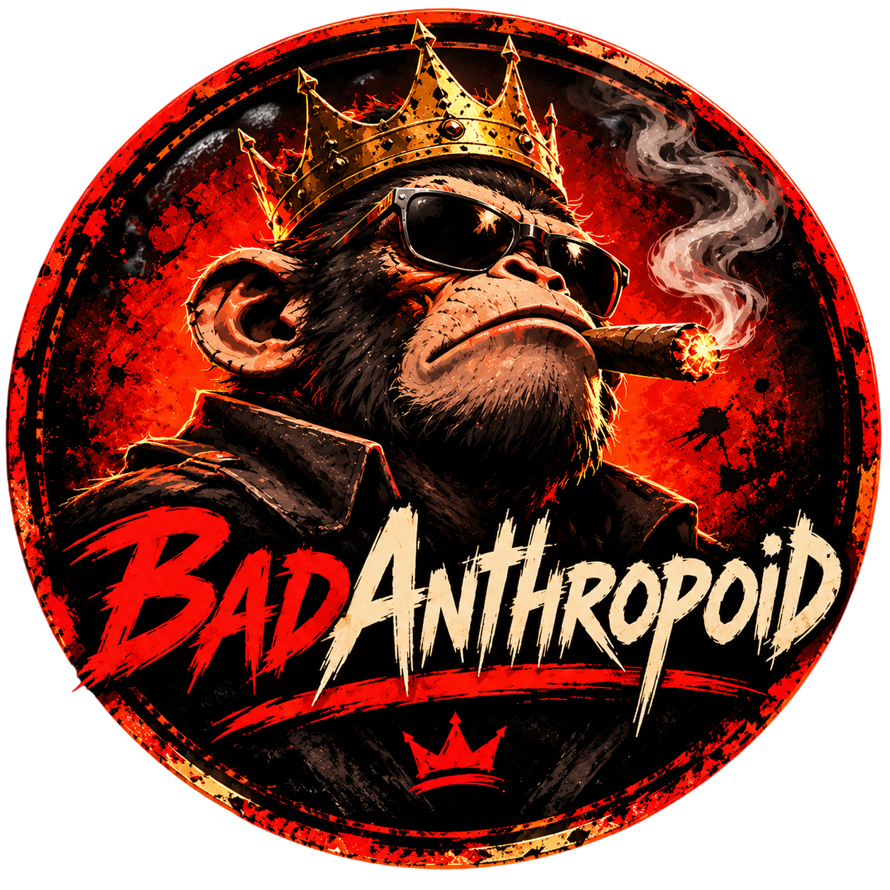

# Omega Formation

<p align="center">
  
</p>

**Omega Formation** is a neon-soaked arcade shoot-'em-up built with **Godot 4.7**. Blast through escalating sectors, graze enemy fire for score, switch between two weapon systems, and break shielded bosses with a charge beam and a launchable companion pod.

> *The battle for the future has only just begun.*

## Features

- **Sector-based campaign** — authored wave formations, laser gates, asteroid fields, mines, and a boss at the end of every sector.
- **Three rotating bosses** — `HOSTILE CORE`, `SENTINEL`, and `SWARM MOTHER` rotate as sectors climb. Each arrives behind two turret pods and escalates through multiple attack phases.
- **Two weapon systems** — `SPREAD` for coverage and `LANCE` for piercing precision fire. Each has three levels.
- **Charge beam** — hold `Shift` to focus, slow down, reveal your hitbox, and release a three-stage beam.
- **Companion pod** — auto-fires at the nearest threat, prioritizes boss turret pods, and can be launched forward for burst damage and bullet clearing.
- **Power-up chaining** — weapon, shield, health, rapid, pierce, speed, and bomb pickups. Maxed pickups convert into Overdrive or salvage points.
- **Score play** — a 3-second combo window, grazing bonuses, bullet-cancel rewards, and flawless boss clears.
- **Local top-10 leaderboard** — persistent high scores with eight-character pilot names.
- **Album soundtrack** — 21 game tracks plus a menu theme, reshuffled every run and crossfaded between tracks. The whole album can be auditioned from Options.
- **Arcade presentation** — animated launch splash, scanlines, vignette, film grain, particles, screen shake, slow-motion boss transitions, and a terminal-styled HUD.

## Controls

| Action | Keyboard |
| --- | --- |
| Move | Arrow keys |
| Fire | `Space` / `Enter` |
| Focus and charge beam | Hold `Shift` |
| Swap weapon mode | `Q` |

lines 1-31
| Deploy companion pod | `E` |
| Use bomb | `X` |
| Pause / back | `Esc` |
| Toggle fullscreen | `F12` |

Movement and fire use Godot's built-in UI actions, so the arrow keys and `Space`/`Enter` are the default bindings. Menus can also be operated with the mouse; use the arrow keys and `Enter`/`Space` to navigate, and `Esc` to go back.

## Gameplay

### Sector loop

A run starts at Sector 01. Each sector plays through an authored wave set with hazards mixed in, then warns of an incoming boss.

The first four sectors use distinct wave tables; later sectors reuse the hardest table with scaled enemy speed, health, and score. Bosses rotate through three archetypes: `HOSTILE CORE`, `SENTINEL`, and `SWARM MOTHER`.

Destroy both turret pods to drop a boss's shield. The fight then enters Phase 02, and at half health it enters Phase 03 with faster attacks and new patterns. Clearing a boss without taking damage during that sector awards a **FLAWLESS** bonus and advances the run.

### Weapons and abilities

| System | Details |
| --- | --- |
| **Spread** | Level 1: single shot. Level 2: three-shot fan. Level 3: wide five-shot fan with a heavier center shot. |
| **Lance** | Level 1: rail. Level 2: twin rail. Level 3: trident. All Lance shots pierce and travel fast, at a slower fire rate. |
| **Charge beam** | Hold `Shift` to focus. Movement slows, the ship's hitbox is revealed, and releasing fires a beam based on charge level 1–3. |
| **Companion pod** | Follows the ship and auto-fires at nearby enemies, preferring boss turret pods. Press `E` to launch it forward; it damages enemies, clears bullets it passes through, and has a 4.5-second cooldown. |
| **Bomb** | Clears enemy bullets, damages or destroys enemies, and grants brief invulnerability. Starts at 1 and caps at 2. |

Weapon level caps at 3. Press `Q` during a run to switch between Spread and Lance. Picking up a weapon at max level grants Overdrive instead.

### Power-ups

| Pickup | Effect |
| --- | --- |
| **Weapon** | +1 weapon level. At max level, grants 10 seconds of Overdrive. |
| **Shield** | +6 seconds of shield. Caps at 12 seconds. |
| **Health** | Restores up to 30 HP. At full health, grants 4 seconds of shield. |
| **Rapid** | +8 seconds of doubled fire rate. Caps at 16 seconds. |
| **Pierce** | +8 seconds of piercing shots. Caps at 16 seconds. |
| **Speed** | +8 seconds of 1.5× movement speed. Caps at 16 seconds. |
| **Bomb** | +1 bomb, up to 2. At max bombs, grants 5 seconds of Overdrive. |

**Overdrive** adds +1 damage to primary shots, multiplies fire interval by 0.8×, and turns those shots gold. It lasts 10 seconds per pickup and caps at 20 seconds.

If a pickup cannot apply any of its effect, it awards **250 salvage points** instead.

### Scoring

- **Combo** — each kill builds combo. The multiplier increases by 0.25× every 5 kills, up to 4×. Letting the 3-second combo window expire or taking damage breaks the chain.
- **Graze** — passing close to enemy bullets awards base graze points, can start or extend a combo, and each bullet can only be grazed once.
- **Bullet cancel** — bombs, boss phase shifts, and boss deaths clear enemy bullets and award points per bullet removed.
- **Flawless clear** — defeat a boss without taking damage in that sector for a `1500 × sector` bonus.
- **Leaderboard** — qualifying runs can be saved on the game-over screen. Scores are kept in a local top-10 table with names up to eight characters.

## Soundtrack and options

The game ships with a 21-track album plus a separate menu theme. Every run reshuffles the album, and tracks crossfade into the next near the end. The menu theme starts during the launch splash and carries into the main menu.

Options are available from the main menu and the pause screen:

- Music and SFX volume
- Fullscreen toggle (also available anywhere with `F12`)
- Album player with previous, play/pause, next, progress, and elapsed/total time

Settings save automatically. Pausing with `Esc` also provides a **Quit to Menu** option.

## Requirements

- **Godot 4.7**
- A GPU capable of running Godot's **GL Compatibility** renderer
- Windows for the included prebuilt build (64-bit)

## Running from source

1. Open `project.godot` in Godot 4.7.
2. Press `F5`, or use **Run Project**.

From a terminal with Godot on `PATH`:

```bash
godot --path .
```

## Prebuilt build

A Windows x86_64 build is included:

```text
release/Omega Formation.exe
release/Omega Formation.pck
```

Run `Omega Formation.exe` and keep `Omega Formation.pck` in the same folder. The `Windows Desktop` preset in `export_presets.cfg` exports to this location. `release.zip` is a packaged archive of the build.

## Project structure

```text
OmegaFormation/
├── project.godot              # Project settings, autoloads, main scene, display config
├── BootSplash.tscn / .gd      # Animated launch splash
├── MainMenu.tscn / .gd        # Main menu, options, leaderboard, credits
├── Game.tscn / .gd            # Gameplay loop, HUD, scoring, pause and game-over flow
├── Player.tscn / .gd          # Ship, weapons, charge beam, power-ups, bombs
├── Enemy.tscn / .gd           # Enemy roles and behaviors
├── Boss.tscn / .gd            # Boss types, phases, shields, and attacks
├── WeakPoint.tscn / .gd       # Destructible boss turret pods
├── WaveDirector.gd            # Authored wave tables, formations, and hazards
├── Drone.tscn / .gd           # Companion pod follow, fire, launch, and return
├── Powerup.tscn / .gd         # Pickup types, sprites, and colors
├── Obstacle.tscn / .gd        # Rocks, mines, and crystals
├── LaserGate.tscn / .gd       # Telegraphed horizontal laser hazard
├── Bullet.tscn / .gd          # Player shots
├── EnemyBullet.tscn / .gd     # Enemy shots
├── ChargeBeam.tscn / .gd      # Charge beam visual and collision
├── SettingsPanel.tscn / .gd   # Shared options and pause panel
├── LeaderboardPanel.tscn / .gd
├── CreditsPanel.tscn / .gd
├── Audio.gd                   # Music/SFX buses, volume, saved settings
├── Music.gd                   # Album discovery, shuffle, crossfades, menu music
├── Scores.gd                  # Local top-10 leaderboard
├── DisplaySettings.gd         # Fullscreen persistence and F12 shortcut
├── UI.gd                      # Shared palette, fonts, and UI theme
├── Migration.gd               # One-time migration of old user data
├── audio/
│   ├── music/                 # Menu theme and 21 shuffled game tracks
│   └── sfx/                   # Laser, hit, explosion, power-up, UI sounds
├── fonts/
├── shaders/
├── sprites/
├── release/                   # Windows x86_64 build
└── release.zip                # Packaged build archive
```

The `project.godot` autoloads are `Migration`, `UI`, `Audio`, `DisplaySettings`, `Scores`, and `Music`.

## Save data

Persistent data is stored in Godot's `user://` directory:

- `settings.cfg` — music/SFX volume and fullscreen preference
- `highscores.json` — local top-10 leaderboard

## Credits

- **Game design and development:** Eugene / Jevgenij — [github.com/eugene77cork](https://github.com/eugene77cork)
- **Music and soundtrack:** CelticRiff — `@celticriff`
- **Engine:** [Godot Engine](https://godotengine.org/)
- **Fonts:** Orbitron, Rajdhani, Share Tech Mono, and DotGothic16. Bundled font licenses are in `fonts/LICENSE.txt`.

Thank you for playing.

## License

Omega Formation is © 2026 Omega Formation. The soundtrack is credited to CelticRiff.
